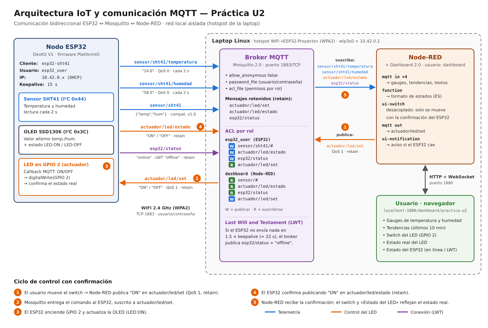

# Documentación — Servicio IoT (Mosquitto + Node-RED + Dashboard)

## 1. Resumen

Esta sección documenta la implementación completa del Servicio IoT del proyecto de monitoreo de confort ambiental: broker MQTT local (Mosquitto, con autenticación y ACL por rol), capa de visualización y control (Node-RED + Dashboard 2.0), y el firmware del ESP32 con el sensor GY-SHT41.

El sistema tiene dos etapas:

- **v1.0 — Monitoreo:** el ESP32 publica temperatura y humedad; el dashboard solo las muestra.
- **Práctica Unidad 2 — Comunicación bidireccional:** además, el dashboard envía comandos al ESP32 (encender/apagar un LED en `GPIO 2`), el ESP32 confirma el estado real del LED y el broker notifica si el ESP32 se desconecta (LWT).



## 2. Cambio de sensor: de BME680 a SHT41

El proyecto inició con un sensor BME680 (temperatura, humedad, presión, gas/IAQ). Tras cablear el sensor correctamente (confirmado con un escáner I2C) y validar que la calibración de fábrica del chip era válida, se detectó que el canal de temperatura devolvía consistentemente un valor crudo `adc_T = 0` — comprobado mediante lectura directa de registros I2C, sin ninguna librería intermedia y sin el calentador de gas activo. Esto descartó causas de software (se probaron 3 versiones de la librería Adafruit_BME680) y confirmó un defecto de hardware específico de esa unidad.

Se sustituyó por un módulo **GY-SHT41** (sensor Sensirion SHT41), que mide únicamente temperatura y humedad relativa, con mayor precisión que el canal equivalente del BME680. Esto redujo el alcance de variables físicas del proyecto de 4 a 2, y redefinió el planteamiento del problema hacia **confort térmico** exclusivamente (sin calidad de aire/CO2).

## 3. Instalación del entorno

```bash
sudo apt update && sudo apt upgrade -y
sudo apt install -y mosquitto mosquitto-clients
sudo systemctl enable --now mosquitto

curl -fsSL https://deb.nodesource.com/setup_20.x | sudo -E bash -
sudo apt install -y nodejs
sudo npm install -g --unsafe-perm node-red
```

Dashboard: **Dashboard 2.0** (paquete `@flowfuse/node-red-dashboard`), instalado desde el editor (menú ☰ → Manage palette → Install).

## 4. Red: hotspot local en la laptop

Para no depender de una red doméstica, el ESP32 se conecta a un **hotspot WiFi creado por la propia laptop** (herramienta `nmcli` de NetworkManager), aislando el sistema de cualquier red externa:

```bash
nmcli device wifi hotspot ifname <interfaz_wifi> ssid ESP32-Proyecto password "<contraseña>"
nmcli connection modify Hotspot ipv4.method shared ipv4.addresses 10.42.0.1/24
```

La segunda línea fija la IP del hotspot de forma permanente (`10.42.0.1`), evitando que cambie en cada activación. Para volver a activarlo después de usar otra red WiFi:

```bash
nmcli connection up Hotspot
```

> La tarjeta WiFi no puede estar en el hotspot y en otra red al mismo tiempo: si la laptop se conecta a la WiFi doméstica, el hotspot se apaga y el ESP32 pierde la conexión con el broker.

## 5. Seguridad de la conexión MQTT

### 5.1 Autenticación obligatoria en Mosquitto

El acceso anónimo está desactivado y cada cliente usa un usuario propio. Para **agregar o cambiar la contraseña** de un usuario:

```bash
sudo mosquitto_passwd /etc/mosquitto/passwd esp32_user
sudo mosquitto_passwd /etc/mosquitto/passwd dashboard
sudo systemctl restart mosquitto
```

> ⚠️ La opción `-c` (`mosquitto_passwd -c ...`) **crea el archivo desde cero y borra a todos los demás usuarios**. Solo debe usarse al crear el primer usuario.

Archivo `/etc/mosquitto/conf.d/local.conf`:
```
listener 1883 0.0.0.0
allow_anonymous false
password_file /etc/mosquitto/passwd
```

Además, la ACL se activa con una línea en algún archivo de `/etc/mosquitto/conf.d/` (debe aparecer **una sola vez**; en esta laptop ya está declarada en el archivo de configuración de otro proyecto que comparte el broker):
```
acl_file /etc/mosquitto/acl
```
Para ver dónde está declarada: `grep -rn acl_file /etc/mosquitto/`.

Mosquitto debe ser dueño de los archivos de credenciales y permisos (versiones futuras se negarán a cargarlos si no):

```bash
sudo chown mosquitto:mosquitto /etc/mosquitto/passwd /etc/mosquitto/acl
sudo chmod 640 /etc/mosquitto/passwd /etc/mosquitto/acl
```

### 5.2 Control de acceso por rol (ACL)

Con un `acl_file` activo, Mosquitto **solo permite los tópicos listados** para cada usuario y **descarta en silencio** todo lo demás (el cliente no recibe ningún error). Se usa un usuario por rol, cada uno con los permisos mínimos que necesita:

| Usuario | Quién lo usa | Publica (write) | Se suscribe (read) |
|---|---|---|---|
| `esp32_user` | ESP32 (`secrets.h`) | `sensor/sht41/#`, `actuador/led/estado`, `esp32/status` | `actuador/led/set` |
| `dashboard` | Node-RED | `actuador/led/set` | `sensor/#`, `actuador/led/estado`, `esp32/status` |

Bloques correspondientes en `/etc/mosquitto/acl`:

```
user dashboard
topic read sensor/#
topic read actuador/led/estado
topic read esp32/status
topic write actuador/led/set

user esp32_user
topic write sensor/sht41/#
topic write actuador/led/estado
topic write esp32/status
topic read actuador/led/set
```

Notas:
- `sensor/sht41/#` también cubre el tópico `sensor/sht41` (JSON de v1.0).
- El permiso de escritura en `esp32/status` es necesario para que el broker publique el mensaje LWT `offline` en nombre del ESP32.
- El archivo ACL puede contener reglas de otros proyectos que comparten el mismo broker; al editarlo, solo se agregan o modifican los bloques de estos dos usuarios. Respaldo previo recomendado: `sudo cp /etc/mosquitto/acl /etc/mosquitto/acl.bak-$(date +%F)`.

### 5.3 Firewall restringido a la subred del hotspot

```bash
sudo ufw allow from 10.42.0.0/24 to any port 1883 proto tcp
```

Solo dispositivos conectados al hotspot (`10.42.0.x`) pueden alcanzar el puerto MQTT; en cualquier otra red (ej. WiFi doméstica o institucional), el puerto queda cerrado por la política de firewall por defecto (`deny incoming`). Node-RED se conecta por `localhost`, que no pasa por esta regla.

### 5.4 Auditoría general de puertos expuestos

Se revisaron todos los puertos en escucha (`ss -tlnp`) y se confirmó que, además de Mosquitto, no había otros servicios expuestos a la red (SSH no estaba instalado, se limpió la regla de firewall correspondiente). Se instaló `fail2ban` como protección general del sistema.

### 5.5 Decisiones de alcance en seguridad

- **TLS/cifrado del canal MQTT**: no implementado. El canal ya está protegido por el cifrado WPA2 del hotspot (adecuado para una red aislada y controlada como la de este proyecto). Se documenta como mejora futura si el sistema migra a una red compartida con terceros.
- **Last Will and Testament (LWT)**: **implementado** en la Práctica U2 (ver sección 6.4). Sustituye al temporizador de inactividad que se había intentado en Node-RED (sección 7.4).

## 6. Firmware del ESP32 (SHT41 + OLED + LED + MQTT)

### 6.1 Librerías y monitor serie (platformio.ini)

```ini
[env:esp32dev]
platform = espressif32
board = esp32dev
framework = arduino
monitor_speed = 115200
monitor_rts = 0
monitor_dtr = 0
lib_deps =
    adafruit/Adafruit SHT4x Library@^1.0.4
    adafruit/Adafruit SSD1306@^2.5.9
    adafruit/Adafruit GFX Library@^1.11.9
    adafruit/Adafruit BusIO@^1.14.5
    knolleary/PubSubClient@^2.8
    bblanchon/ArduinoJson@^7.1.0
```

`monitor_rts = 0` y `monitor_dtr = 0` evitan que el monitor serie mantenga el ESP32 en reset en placas con convertidor USB tipo CH9102/CH343 (aparecen como `/dev/ttyACM*`). Ver sección 9.

### 6.2 Diseño no bloqueante

Todas las tareas corren de forma independiente con temporizadores basados en `millis()`, sin `delay()`:

| Tarea | Intervalo |
|---|---|
| Lectura del SHT41 y publicación MQTT | 2 s |
| Alternar la OLED (temperatura ↔ humedad) | 3 s |
| Reintento de conexión WiFi | 5 s |
| Reintento de conexión MQTT | 3 s |

La reconexión también es no bloqueante: si se pierde la red, el ESP32 sigue leyendo el sensor y actualizando la OLED mientras reintenta en segundo plano (la versión v1.0 se quedaba detenida en un `while` hasta reconectar).

### 6.3 Tópicos MQTT

| Tópico | Dirección | Payload | QoS | Retain |
|---|---|---|---|---|
| `sensor/sht41/temperatura` | publica | `"24.6"` (°C, 1 decimal) | 0 | no |
| `sensor/sht41/humedad` | publica | `"58.0"` (%RH, 1 decimal) | 0 | no |
| `sensor/sht41` | publica | `{"temp": 24.6, "hum": 58.0}` (compatibilidad v1.0) | 0 | no |
| `actuador/led/estado` | publica | `ON` / `OFF` | 0 | sí |
| `esp32/status` | publica / LWT | `online` / `offline` | 0 | sí |
| `actuador/led/set` | suscribe | `ON` / `OFF` | 1 | sí (lo retiene Node-RED) |

Conexión autenticada con usuario/contraseña de `secrets.h` (`esp32_user`), client ID `esp32-sht41` y keepalive de 15 s.

### 6.4 Control del LED con confirmación y LWT

- **Comando:** el callback MQTT recibe `actuador/led/set`, acepta `ON`/`OFF` sin importar mayúsculas y espacios finales, e ignora cualquier otro valor (lo reporta por el monitor serie).
- **Acción:** `digitalWrite(GPIO 2)`. El LED arranca apagado al encender el ESP32.
- **Confirmación:** después de cambiar el pin, el ESP32 publica el estado real en `actuador/led/estado` (retenido) y actualiza la OLED de inmediato.
- **Reinicio:** como `actuador/led/set` es retenido, al reconectarse el ESP32 recibe el último comando y restaura el estado del LED.
- **LWT:** al conectarse registra `esp32/status = offline` como "última voluntad" y publica `online`. Si deja de comunicarse durante más de 1.5 × keepalive (≈ 22 s), el broker publica `offline` automáticamente.

### 6.5 Pantalla OLED

Alterna cada 3 s entre temperatura y humedad (valor grande) y muestra **siempre** el estado del LED en la esquina superior derecha:

```
Temperatura      LED:ON
24.6 C
```

## 7. Flujo de Node-RED (`node-red/dashboard.json`)

### 7.1 Conexión al broker

Nodo de configuración `mqtt-broker` "Mosquitto local":
- Server: `localhost:1883` (Node-RED corre en la misma laptop que Mosquitto)
- Security: usuario `dashboard` y su contraseña

> Los flujos exportados **no incluyen credenciales**. Después de importar el archivo hay que capturar usuario y contraseña en la pestaña *Security* de "Mosquitto local" y hacer Deploy.

### 7.2 Nodos

| Nodo | Tópico | Salida |
|---|---|---|
| `mqtt in` Temperatura (JSON) | `sensor/sht41/temperatura` | Gauge + tendencia de temperatura |
| `mqtt in` Humedad (JSON) | `sensor/sht41/humedad` | Gauge + tendencia de humedad |
| `mqtt in` Estado real del LED (texto) | `actuador/led/estado` | Switch (entrada) + texto "Estado del LED" |
| `ui-switch` Switch LED | — | `mqtt out` → `actuador/led/set` (QoS 1, retain) |
| `mqtt in` Estado ESP32 (texto) | `esp32/status` | Texto "ESP32" + notificación emergente al desconectarse |
| `debug` Depuración MQTT | — | Desactivado por defecto; se activa para ver todos los mensajes |

El **switch está desacoplado** (`decouple`): al hacer clic envía el comando, pero solo cambia de posición cuando llega la confirmación en `actuador/led/estado`. Si el ESP32 está apagado, el switch no se mueve.

### 7.3 Widgets del dashboard (`/dashboard/practica-u2`)

| Grupo | Widget | Detalle |
|---|---|---|
| Ambiente (SHT41) | Gauge Temperatura | 0–50 °C · azul < 18, verde 18–28, amarillo 28–35, rojo ≥ 35 |
| | Gauge Humedad | 0–100 % · amarillo < 30, verde 30–60, azul ≥ 60 |
| | Tendencias | Temperatura y humedad, últimos 10 minutos |
| Control y estado | Switch LED (GPIO 2) | Envía ON/OFF; refleja el estado confirmado |
| | Estado del LED | 🟢 ENCENDIDO / ⚫ APAGADO |
| | ESP32 | 🟢 En línea / 🔴 Desconectado (LWT) |

### 7.4 Historial: reinicio a cero por inactividad (descartado)

En v1.0 se diseñó un nodo `trigger` para resetear los gauges si el ESP32 dejaba de publicar. No reenviaba correctamente los mensajes intermedios y se retiró. En la Práctica U2 se resolvió con **LWT**: la desconexión la reporta el propio broker, sin temporizadores estimados en Node-RED.

## 8. Validación end-to-end

Con Mosquitto, Node-RED, el hotspot y el ESP32 activos:

1. **Monitor serie:** tras presionar EN aparece `Conectando a broker MQTT... conectado.` y una lectura cada 2 s.
2. **Telemetría** (con el usuario `dashboard`):
   ```bash
   mosquitto_sub -h localhost -u dashboard -P '<contraseña>' -v \
     -t 'sensor/sht41/#' -t 'actuador/led/estado' -t 'esp32/status'
   ```
   Se reciben `esp32/status online`, `actuador/led/estado OFF` y lecturas cada 2 s.
3. **Comando:**
   ```bash
   mosquitto_pub -h localhost -u dashboard -P '<contraseña>' -t actuador/led/set -m ON -r
   ```
   El LED enciende, la OLED muestra `LED:ON` y se recibe `actuador/led/estado ON`.
4. **ACL:** el mismo comando enviado con `esp32_user` **no** tiene efecto (el dispositivo no tiene permiso para enviar comandos).
5. **Dashboard:** gauges y tendencias se actualizan; el switch enciende y apaga el LED y "Estado del LED" cambia con la confirmación.
6. **LWT:** al desconectar el ESP32, en ≈ 20 s el dashboard muestra 🔴 Desconectado y un aviso; al reconectarlo vuelve a 🟢 En línea y el LED recupera el último estado.

Para borrar el comando retenido del broker: `mosquitto_pub ... -t actuador/led/set -r -n`.

## 9. Problemas encontrados y soluciones

| Síntoma | Causa | Solución |
|---|---|---|
| El ESP32 imprime "Publicado en MQTT" y Node-RED aparece "connected", pero el dashboard no recibe nada | El `acl_file` (compartido con otro proyecto) solo permitía a `esp32_user` escribir en `sensor/sht41`; Mosquitto descarta en silencio los tópicos no autorizados | Agregar los tópicos de la práctica a la ACL con permisos por rol (sección 5.2). Diagnóstico: `mosquitto_sub -t '#'` no recibía nada y `grep -rn acl /etc/mosquitto/` mostró el `acl_file` |
| Nodos MQTT de Node-RED en "connecting" | Al importar el flujo no se importan las credenciales; después, contraseña incorrecta para el usuario configurado | Capturar usuario/contraseña en "Mosquitto local" → Security. El log `/var/log/mosquitto/mosquitto.log` muestra `not authorised` cuando la contraseña es incorrecta |
| Dashboard: "multiple pages configured with the same URL" | Otra página del mismo Node-RED ya usaba `/monitoreo` | Cambiar la ruta de la página a `/practica-u2` |
| Monitor serie en blanco | El monitor abría después de que el ESP32 ya había impreso los mensajes de arranque, o mantenía el chip en reset por las líneas RTS/DTR | Presionar EN con el monitor abierto; agregar `monitor_rts = 0` y `monitor_dtr = 0` |
| Upload falla con `Could not open /dev/ttyS0` | PlatformIO no encontró la placa (un monitor viejo retenía el puerto y la placa reapareció como `/dev/ttyACM1`) | Cerrar todas las terminales, reconectar el USB y verificar con `ls /dev/ttyACM*`; opcionalmente fijar `upload_port` / `monitor_port` |
| La placa no aparece en `dmesg` ni en `lsusb` (LED rojo encendido) | Falla de datos USB: cable, conector o puerto | Probar otro cable de datos y otro puerto; revisar el conector |
| `Error: no se pudo inicializar el SHT41` | El sensor no respondía en el bus I2C (conexión floja tras modificar la protoboard) | Desconectar la alimentación, revisar las 4 conexiones del SHT41 y verificar con `firmware/esp32-scanner-i2c` que aparezcan `0x44` y `0x3C` |
| El escáner I2C se queda en "Escaneando bus I2C..." | Bus I2C bloqueado (SDA o SCL en bajo) | Desconectar la alimentación por completo y aislar módulo por módulo hasta encontrar la conexión en falla |
| ESP32 sin conexión al broker | La laptop se conectó a otra red WiFi y apagó el hotspot | `nmcli connection up Hotspot` |
| Advertencia `File ... owner is not mosquitto` | Archivos `passwd`/`acl` con dueño `root` | `chown mosquitto:mosquitto` (sección 5.1) |
