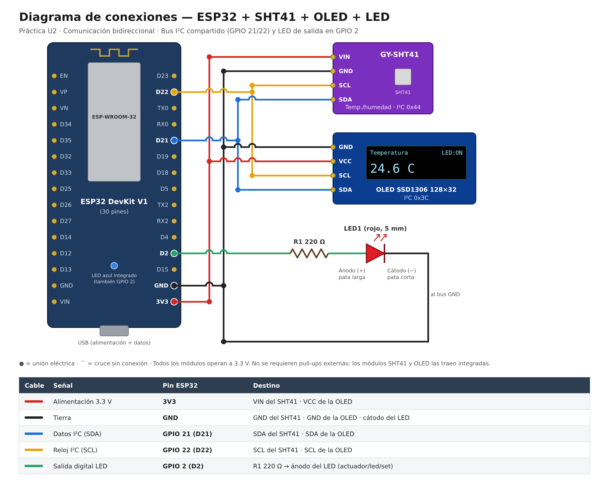

# Hardware — Lista de materiales y conexión

## Lista de materiales (BOM)

| # | Componente | Especificación | Cantidad |
|---|---|---|---|
| 1 | Microcontrolador | ESP32 DevKit V1, 30 pines (WiFi + Bluetooth) | 1 |
| 2 | Sensor ambiental | GY-SHT41 (Sensirion SHT41: temperatura y humedad de alta precisión), módulo I2C | 1 |
| 3 | Pantalla | OLED 128x32, controlador SSD1306, interfaz I2C | 1 |
| 4 | Actuador | LED de 5 mm (rojo) | 1 |
| 5 | Resistencia | 220 Ω, 1/4 W (limitadora de corriente del LED) | 1 |
| 6 | Protoboard | Breadboard estándar (830 puntos) | 1 |
| 7 | Cables | Jumper wires macho-macho | ~12 |
| 8 | Alimentación | Cable USB **de datos** para el ESP32 (algunos cables solo cargan) | 1 |

**Nota sobre el cambio de sensor:** el proyecto inició con un módulo BME680, descartado tras un diagnóstico exhaustivo que confirmó un defecto de hardware específico en su canal de temperatura (el chip reportaba consistentemente `adc_T = 0` en el registro crudo, incluso sin librerías ni calentador de gas activo — ver sección de diagnóstico en `docs/documentacion_servicio_iot.md`). Se sustituyó por un GY-SHT41, que solo mide temperatura y humedad (sin presión ni IAQ/gas), lo cual redefinió el alcance del problema hacia confort térmico únicamente.

## Diagrama de conexión

Versión editable: [`diagrama_conexiones.svg`](diagrama_conexiones.svg).

### Bus I2C compartido (SHT41 + OLED)

El ESP32, el SHT41 y la pantalla OLED comparten un mismo bus I2C de 4 líneas.

| Señal | Pin ESP32 | Destino |
|---|---|---|
| Alimentación | `3V3` | VIN del SHT41 y VCC de la OLED |
| Tierra | `GND` | GND del SHT41, GND de la OLED y cátodo del LED |
| Datos I2C | `GPIO21` (SDA) | SDA del SHT41 y de la OLED |
| Reloj I2C | `GPIO22` (SCL) | SCL del SHT41 y de la OLED |

**Direcciones I2C (confirmadas con el escáner `firmware/esp32-scanner-i2c`):**
- SHT41: `0x44` (dirección por defecto)
- OLED SSD1306: `0x3C`

### LED de salida (Práctica U2)

| Señal | Pin ESP32 | Destino |
|---|---|---|
| Salida digital | `GPIO2` (D2) | Resistencia de 220 Ω → ánodo del LED (pata larga) |
| Tierra | `GND` | Cátodo del LED (pata corta) |

Circuito: `GPIO2 → R 220 Ω → LED (ánodo → cátodo) → GND`. Con 3.3 V y un LED rojo (~2 V de caída) la corriente es de ≈ 6 mA, dentro del límite del pin.

Total de conexiones físicas al ESP32: **5 pines** (3V3, GND, GPIO21, GPIO22 y GPIO2); el bus I2C se reparte en paralelo entre ambos módulos.

## Notas de montaje

- No se requirieron resistencias pull-up adicionales — ambos módulos (SHT41 y OLED) traen pull-ups integradas en su breakout.
- El ESP32 opera a lógica de 3.3V; todos los módulos son compatibles nativamente.
- `GPIO2` también controla el **LED azul integrado** del DevKit, por lo que ambos encienden juntos (útil para verificar el firmware sin el LED externo).
- `GPIO2` es un pin de *strapping* del arranque; un LED con resistencia a GND no interfiere con el arranque ni con la carga del firmware.
- Al modificar la protoboard, desconecta el USB primero. Un cable en la fila equivocada puede bloquear el bus I2C (el escáner se queda en "Escaneando bus I2C...") o impedir que el SHT41 responda.

## Diagnóstico rápido

1. Cargar `firmware/esp32-scanner-i2c` y abrir el monitor serie: deben aparecer `0x3C` y `0x44`.
   - Solo `0x3C` → revisar cableado/soldadura del SHT41.
   - Ningún dispositivo o el escaneo no termina → revisar GND, GPIO21/22 y posibles cortos en la protoboard.
2. Si la placa no aparece en `/dev/ttyACM*` / `/dev/ttyUSB*` (ni en `lsusb`) pero el LED rojo de encendido está prendido → probar otro cable de datos u otro puerto USB.
